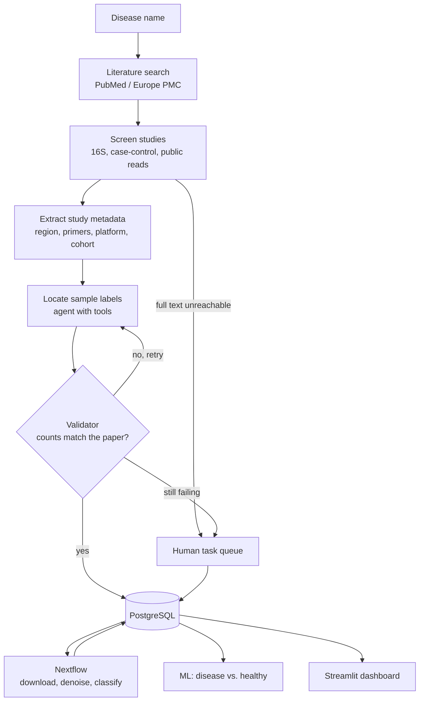
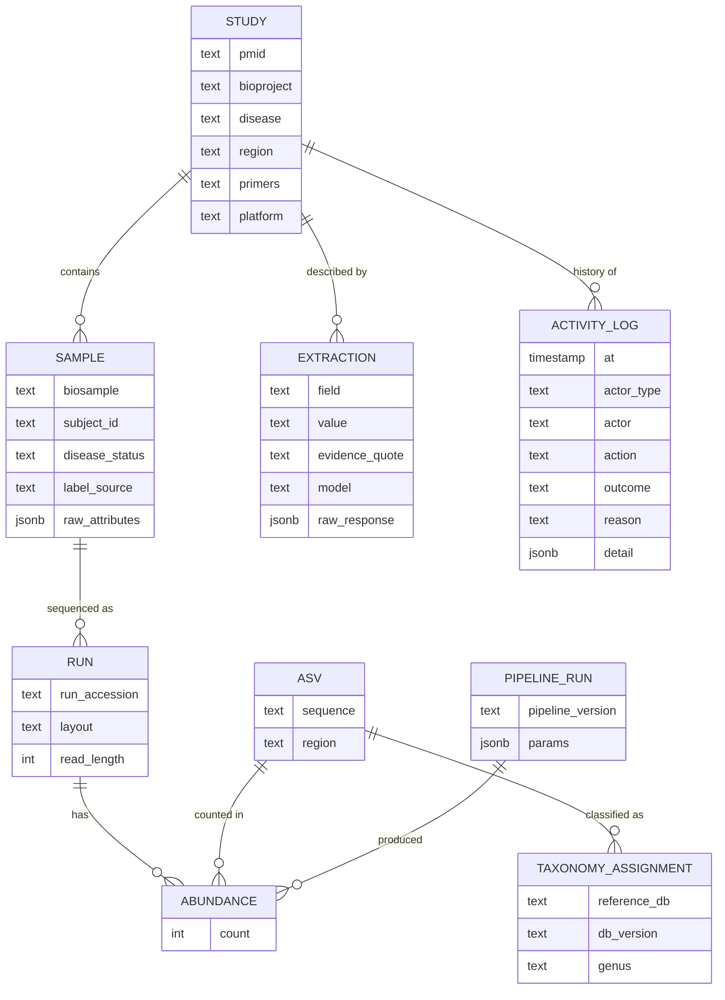

# agentic-16s

**An LLM-driven pipeline that turns published 16S rRNA microbiome studies into an analysis-ready database.**

Give it a disease name. It finds the papers, reads them, locates the per-sample labels, downloads the raw reads, runs one uniform bioinformatics workflow, and loads everything into PostgreSQL for machine learning and a dashboard.

> **Status: design phase.** This document describes the planned architecture. Nothing below is implemented yet; the [roadmap](#roadmap) tracks what exists.

## Why this project

Thousands of 16S studies have deposited raw reads in public archives, but reusing them across studies is slow manual work:

- The facts needed to process a dataset correctly (amplified region, primers, platform, case definition) are written in the paper's methods section, not in the archive.
- Per-sample labels (who is a case, who is a control) live in a different place for every study: archive sample attributes, a supplementary spreadsheet, a PDF table, or nowhere.
- Sample names in the paper rarely match run accessions in the archive.

A human curator needs hours per study. This project tests how much of that curation an LLM agent can do reliably, and measures it.

16S amplicon data is a deliberate choice: datasets are small enough to process dozens of studies on a single desktop machine.

## How it works

### Fixed outer workflow, agentic inner step

Most stages are a fixed sequence, so every run is traceable and can be resumed from any stage.

One stage cannot be scripted: **locating sample labels**. Every study stores them differently, so this stage is an agent with a set of tools (read archive sample attributes, list supplementary files, parse a spreadsheet, read a PDF table) that decides for itself where to look next.

### The agent does not grade its own work

The label-locating agent must return a table mapping every run accession to a case/control label and the source of that label. Plain code then checks the table against the paper: total samples, number of cases, number of controls. A mismatch triggers a retry; repeated failure sends the study to the human task queue.

### Humans handle what the agent cannot reach

Some obstacles are not reasoning problems. A paper sits behind a paywall, a publisher blocks automated access, or a supplementary file is only available by emailing the authors. The agent does not try to work around these. It records exactly what is missing and why, opens a task for a person, and moves on to the next study. When the person supplies the file (for example, a legally obtained PDF), the study resumes from where it stopped.

### One activity log for agents and humans

Every action on a study is written to the same log, whoever performed it: what was attempted, by which agent or person, with what input, and how it ended (success, failure, blocked, skipped). A failed download and a human uploading the missing PDF are two entries in one timeline.

The log makes each study's state readable at any time: which paper is missing, which labels were never found, which runs failed to process. It is written from the first version, because history cannot be reconstructed afterwards. What is built on top of it comes later (see the [roadmap](#roadmap)).

### Linking paper sample names to archive runs

A supplementary table says `P012_plaque`; the archive says `SRR1234567`. Joining the two is its own validated step, because it is the easiest place to silently mislabel samples.

### Traceable and replayable LLM steps

LLM output is not deterministic, so reproducibility comes from the surrounding system:

- Model versions are pinned and prompts are version-controlled files.
- Every raw LLM response is stored. Downstream steps read the stored response instead of calling the model again.
- Every extracted field carries a verbatim quote from the source, and code confirms the quote exists in the document.

## Design principles

**Store everything, decide later.** Data is kept in three layers:

| Layer | Contents | Purpose |
|---|---|---|
| Raw | Archive attributes as JSONB, raw LLM responses, supplementary tables as found | Nothing is lost; curation rules can change without re-downloading or re-calling a model |
| Curated | Normalized fields (disease status, sex, age, region, …), each with its source and evidence | The trusted record |
| Analysis | Views and wide tables | Input for ML and the dashboard |

**Keep sequences and counts, not just taxonomy.** ASV sequences and raw counts are stored, so samples can be re-classified against a new reference database or aggregated differently later.

**Record every technical variable per sample.** Amplified region, primers, platform, read length, layout, pipeline version, and reference database version are stored with each sample. They are the covariates for the batch-effect work described under [Known limitations](#known-limitations).

**Provider-agnostic LLM layer.** Schemas, prompts, and tools are independent of both the model vendor and the orchestration framework. Changing the model is a configuration change.

## Tech stack

| Component | Choice | Notes |
|---|---|---|
| Agent orchestration | LangGraph | Checkpoints, replay from any node, human-in-the-loop interrupts. Prototyped first with Claude Code subagents. |
| LLM access | Any provider via LangChain chat models | Models are compared on a gold set |
| Extraction schemas | Pydantic | Shared by the prototype and the production graph |
| Bioinformatics | Nextflow, building on [nf-core/ampliseq](https://nf-co.re/ampliseq) | Cutadapt, DADA2, taxonomic classification |
| Database | PostgreSQL | JSONB for raw attributes |
| ML | scikit-learn | Leave-one-study-out cross-validation |
| Dashboard | Streamlit | |
| Infrastructure | Docker Compose, GitHub Actions | Docker Compose is added in Phase 6; the prototype uses a local PostgreSQL |

## Database sketch

## Evaluation

**Extraction quality.** A hand-labeled gold set of 10–20 papers gives per-field accuracy. Several models are compared on accuracy and cost per paper. Existing human-curated resources serve as a second source of ground truth where they overlap.

**Classifier quality.** Models are scored with leave-one-study-out cross-validation: train on all studies but one, test on the held-out study. A random split would reward the model for recognizing which study a sample came from. Splits are also grouped by subject, so repeated samples from one person never sit on both sides.

## Roadmap

- [ ] **Phase 0 — Choose the disease with data.** For several candidates (e.g. IBD, colorectal cancer, periodontitis, type 2 diabetes), count papers, the share with public reads, samples with recoverable case/control labels, and the spread of amplified regions. The disease with the most *usable* data becomes the target.
- [ ] **Phase 1 — Schema.** PostgreSQL schema with the three layers and the activity log, migrations. Runs on a locally installed PostgreSQL.
- [ ] **Phase 2 — Extraction prototype.** Pydantic schemas, prompts, and tools, run with Claude Code subagents. Build the gold set.
- [ ] **Phase 3 — Bioinformatics.** Nextflow workflow from a database-generated samplesheet to loaded ASV tables.
- [ ] **Phase 4 — Minimal loop.** One disease, 5–10 studies, from literature search through to the database.
- [-] **Phase 5 — LangGraph.** Port the orchestration; add checkpoints, tracing, and the human review step. this is for future, not in mvp.
- [ ] **Phase 6 — ML and dashboard.** Leave-one-study-out classifier; Streamlit pages for studies, cohorts, composition, and model results. Docker Compose to start the database and dashboard with one command.
- [ ] **Phase 7 — Scale out.** More studies; start the cross-study heterogeneity analysis.

### After the MVP

- [ ] **Gap reports.** An agent reads the activity log and the database and reports, per study and per disease, what is still missing: papers to obtain, labels to recover, runs to reprocess.
- [ ] **Evidence gaps and study proposals.** The same view across a whole disease shows what the public data cannot answer (under-represented populations, sample types, or regions). An agent drafts proposals for the new experiment or clinical study that would fill the gap, for a scientist to review.

## Known limitations

- **Cross-region comparability.** ASVs from different 16S regions (V1–V3, V3–V4, V4) are not directly comparable. The first version processes each study separately and merges at genus level. A systematic study of region and batch effects is planned once the database is large enough to support it; the schema already stores what that analysis needs.
- **Automated fetching is open-access only.** Full text is fetched programmatically only from the PMC Open Access subset. Other papers enter the pipeline only when a person supplies a legally obtained copy. Paper text is never committed to this repository.
- **Labels are sometimes unrecoverable.** Studies whose per-sample labels cannot be found or validated are recorded and excluded, not guessed.
- **Disk space.** Raw FASTQ files are deleted after processing; the database keeps the accessions needed to fetch them again.

## Related resources

[Qiita](https://qiita.ucsd.edu/), [GMrepo](https://gmrepo.humangut.info/), and [MicrobiomeDB](https://microbiomedb.org/) offer curated microbiome datasets built largely by manual curation. This project asks a different question: how far an LLM agent can automate that curation, with measured accuracy and evidence for every extracted fact.

## License

To be decided.
